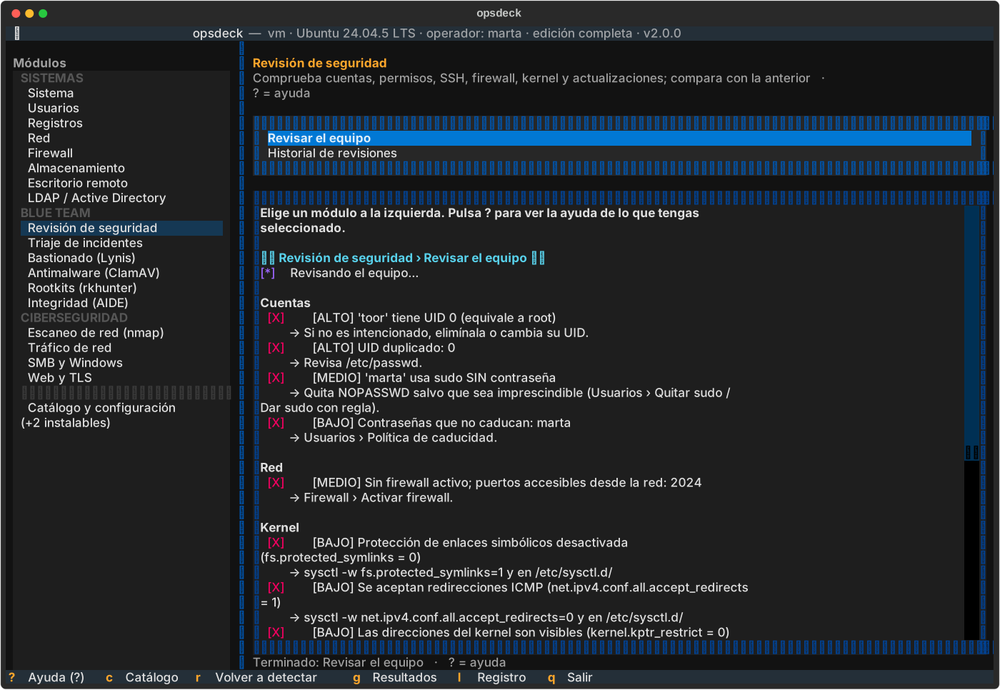
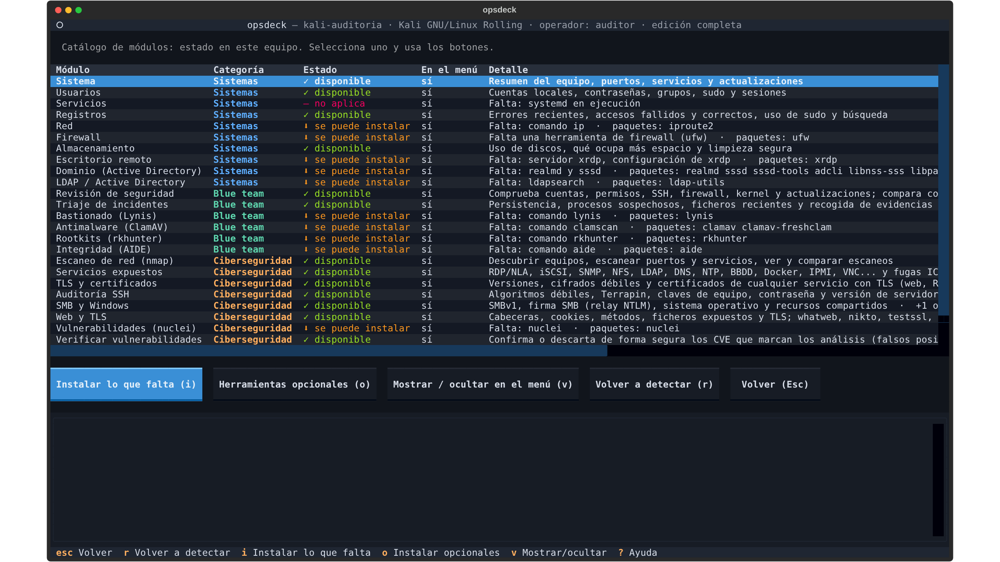

<div align="center">

# opsdeck

**Sistemas y ciberseguridad para Linux en una sola herramienta.**

Administra equipos, únelos a Active Directory, revisa su seguridad, analiza redes y tráfico
y responde a incidentes, desde un menú visual en la terminal o en una línea de comando.

[](https://github.com/THRaven426/opsdeck/stargazers)
[](https://github.com/THRaven426/opsdeck/commits/main)




</div>

> [!WARNING]
> **opsdeck es una herramienta potente.** La edición completa captura tráfico, escanea redes y busca
> vulnerabilidades de forma activa. Está hecha para **equipos de sistemas, seguridad y respuesta a
> incidentes** que trabajan sobre **su propia infraestructura o con autorización por escrito**.
> Usarla contra sistemas ajenos sin permiso es ilegal. Cada acción queda registrada con su operador.

## Índice

- [Qué hace](#qué-hace)
- [Ediciones: ligera y completa](#ediciones-ligera-y-completa)
- [Instalación](#instalación)
- [Primeros pasos](#primeros-pasos)
- [Módulos](#módulos)
- [Cómo funciona por dentro](#cómo-funciona-por-dentro)
- [Seguridad y uso responsable](#seguridad-y-uso-responsable)
- [Desarrollo](#desarrollo)
- [Hoja de ruta](#hoja-de-ruta)

## Qué hace

| | |
|---|---|
| 🧭 **Se adapta a cada equipo** | En cada arranque detecta qué hay instalado y solo muestra lo que funciona ahí. Si mañana instalas xrdp, su módulo aparece solo. |
| 📦 **Instala lo que falta, como apt** | Enseña los paquetes, las dependencias y el tamaño, y pide confirmación. Nada se instala sin un sí. |
| ❓ **Ayuda en cada pantalla** | La tecla `?` explica el módulo o la acción que tengas seleccionada, con el comando equivalente. |
| 🖱️ **Para expertos y para quien no lo es** | Menú con ratón y formularios, o todo en una línea para automatizar. |
| 🧾 **Todo queda registrado** | Quién hizo qué y cuándo, en fichero con rotación y en el journal. Las contraseñas nunca se guardan. |
| 🛟 **Difícil romper algo** | Confirmación en lo delicado, copia previa de las cuentas, y no deja bloquearte a ti mismo ni cortar tu propio acceso remoto sin avisar. |
| 🗂️ **Resultados guardados y comparables** | Escaneos, revisiones y análisis se guardan; la herramienta te dice qué ha cambiado desde la vez anterior. |

<div align="center">

| Formularios guiados | Catálogo de módulos |
|:---:|:---:|
|  |  |

</div>

## Ediciones: ligera y completa

Un solo programa, dos ediciones. Se elige al instalar y se puede cambiar reinstalando.

| | **Ligera** | **Completa** |
|---|:---:|:---:|
| Pensada para | Administración de sistemas y de dominio, día a día | Equipos de seguridad y respuesta a incidentes |
| Sistema, usuarios, servicios, registros, red, firewall, discos | ✅ | ✅ |
| Escritorio remoto (xrdp) | ✅ | ✅ |
| Unir el equipo a Active Directory y dejarlo seguro | ✅ | ✅ |
| Consultas LDAP y revisión del AD (solo lectura) | ✅ | ✅ |
| Revisión de seguridad del equipo | ✅ | ✅ |
| Escaneo de red: descubrir equipos, perfiles rápido y estándar | ✅ | ✅ |
| Escaneo completo, de vulnerabilidades, UDP, sigiloso y personalizado | — | ✅ |
| Tráfico de red: captura, análisis y descubrimiento pasivo | — | ✅ |
| Triaje de incidentes y recogida de evidencias | — | ✅ |
| Bastionado (Lynis), antimalware, rootkits, integridad | — | ✅ |
| SMB y Windows, web y TLS, vulnerabilidades (nuclei) | — | ✅ |
| Acceso | Cualquier administrador del equipo | Solo miembros del grupo `opsdeck-completa` |

En la edición completa, los módulos avanzados solo los puede usar quien esté en el grupo
`opsdeck-completa`. Quien instala queda dentro; a los demás se les añade con
`sudo gpasswd -a <usuario> opsdeck-completa`.

> [!NOTE]
> Ese grupo ordena quién usa qué y deja rastro en la auditoría, pero no es una barrera frente a
> alguien con root en el equipo. El control real es **quién tiene acceso a este repositorio y a
> las máquinas donde se instala la edición completa**.

## Instalación

```bash
git clone https://github.com/THRaven426/opsdeck.git
cd opsdeck
sudo ./install.sh                      # pregunta la edición y qué va a instalar
```

Sin preguntas: `sudo ./install.sh --si --edicion ligera` (o `completa`).

El instalador muestra lo que hará y espera tu confirmación. Crea `/opt/opsdeck` con su propio entorno
Python, el comando `opsdeck`, y las carpetas de configuración, datos y registros. No toca nada más.

| | |
|---|---|
| Requisitos | Linux con Python 3.10+ (lo instala si falta) y salida a PyPI durante la instalación |
| Probado en | Ubuntu 24.04. Pensado para Debian, Ubuntu y Kali. RHEL, SUSE y Arch: soporte básico, sin probar |
| Herramientas de los módulos | Se instalan después, cuando las pidas: `opsdeck instalar todo` o desde el Catálogo |
| Actualizar | `opsdeck autoactualizar` |
| Desinstalar | `sudo /opt/opsdeck/uninstall.sh` (conserva datos y registros salvo que digas lo contrario) |

## Primeros pasos

```bash
opsdeck
```

> Escribe solo `opsdeck`: la herramienta pide la contraseña de `sudo` ella sola. No hace falta
> `sudo opsdeck` (y en algunos sistemas `sudo` no encuentra el comando en `/usr/local/bin`).

| Tecla | Qué hace |
|:---:|---|
| `↑` `↓` `Intro` | Moverse y elegir (también con el ratón) |
| `?` | Ayuda de lo que tengas seleccionado |
| `c` | Catálogo: todos los módulos, instalar lo que falta, ocultar lo que no uses |
| `g` | Resultados guardados |
| `l` | Registro de cambios |
| `s` | Detener la acción en curso |
| `q` | Salir |

Todo lo del menú se puede lanzar también así:

```bash
opsdeck modulos                                   # qué hay disponible en este equipo
opsdeck ayuda dominio unir                        # qué pide una acción
opsdeck usuarios crear --usuario jperez --grupos sudo
opsdeck revision revisar                          # revisión de seguridad
opsdeck escaneo descubrir --objetivo 192.168.0.0/24
opsdeck trafico capturar --interfaz eth0 --segundos 60     # edición completa
opsdeck registro 20 jperez                        # quién tocó esa cuenta
```

La guía completa está en [HELP.md](HELP.md) y dentro de la herramienta.

## Módulos

### 🖥️ Sistemas

| Módulo | Qué resuelve |
|---|---|
| **Sistema** | Estado del equipo, puertos en escucha, servicios con fallos, actualizaciones |
| **Usuarios** | Cuentas locales, contraseñas, grupos, sudo, sesiones, claves SSH, política de caducidad, inventario CSV |
| **Servicios** | systemd: estado con registros, arrancar, parar, reiniciar, arranque automático, timers |
| **Registros** | Errores recientes, accesos fallidos por IP y usuario, accesos correctos, uso de sudo, búsqueda |
| **Red** | Interfaces, rutas, DNS, conexiones activas y "no llego a tal servidor" (DNS, ping, puerto) |
| **Firewall** | ufw o firewalld: reglas, abrir puertos por origen, activar sin cortar SSH ni RDP |
| **Almacenamiento** | Discos e inodos, qué ocupa más, ficheros grandes, limpieza segura |
| **Escritorio remoto** | xrdp: quién entra, por qué alguien no puede, limitar el acceso a un grupo |
| **Dominio (Active Directory)** | Unir el equipo al dominio y adaptarlo a cada implantación: quién entra, grupo administrador, GPO de inicio de sesión, acceso sin conexión, verificación de la configuración |
| **LDAP / Active Directory** | Solo lectura: buscar usuarios, miembros anidados, exportar, revisión de seguridad del directorio |

### 🛡️ Blue team

| Módulo | Edición | Qué resuelve |
|---|:---:|---|
| **Revisión de seguridad** | ligera | Los fallos habituales de cuentas, permisos, SSH, firewall, kernel y parches, con su solución y comparados con la revisión anterior |
| **Triaje de incidentes** | completa | Persistencia, procesos sospechosos, ficheros recientes y SUID; recogida de evidencias con manifiesto SHA-256 |
| **Bastionado (Lynis)** | completa | Índice de bastionado de 0 a 100 y su evolución |
| **Antimalware (ClamAV)** | completa | Análisis de carpetas y cuarentena |
| **Rootkits (rkhunter)** | completa | Rootkits y binarios alterados |
| **Integridad (AIDE)** | completa | Qué ficheros del sistema han cambiado respecto a una referencia |

### 🔎 Análisis y ciberseguridad

| Módulo | Edición | Qué resuelve |
|---|:---:|---|
| **Escaneo de red (nmap)** | ligera / completa | Descubrir equipos, perfiles de escaneo, resumen de una línea por equipo y comparación entre escaneos |
| **Tráfico de red** | completa | Captura y resumen: quién habla con quién, DNS, protocolos sin cifrar, señales de suplantación ARP; descubrimiento pasivo sin enviar un paquete |
| **SMB y Windows** | completa | SMBv1, firma SMB (relay NTLM), recursos accesibles sin credenciales o con una cuenta |
| **Web y TLS** | completa | Certificados que caducan, TLS obsoleto y cabeceras, de una web o de todas las del último escaneo; whatweb, nikto, testssl y rutas si están instalados |
| **Vulnerabilidades (nuclei)** | completa | Vulnerabilidades conocidas comprobadas con plantillas |
| **Fuentes de datos** | ligera / completa | Antigüedad y actualización de las bases de detección: plantillas de nuclei, exploit-db y parches |

Tras un escaneo, un análisis SMB o una revisión web, opsdeck añade un apartado **«Recomendaciones
(siguiente paso)»**: por cada hallazgo propone qué confirmar, mitigar o parchear, señala la acción o
herramienta que toca y, cuando aplica, consulta en exploit-db si hay **exploit público** para priorizar.
Recomienda y señala; no explota ni lanza nada por su cuenta, y respeta la barandilla de alcance.

> La administración del propio Active Directory (altas, grupos, GPO) queda fuera a propósito:
> opsdeck configura y revisa el lado Linux.

## Cómo funciona por dentro

```
install.sh / uninstall.sh   instalación con confirmación y elección de edición
HELP.md                     guía de uso (la misma que se ve con ?)
opsdeck/
  cli.py                    línea de comandos
  core/                     detección, paquetes, ediciones, auditoría, configuración, resultados
  modules/                  un fichero por módulo
  ui/                       interfaz visual (Textual)
tests/                      pruebas del núcleo y de la interfaz
```

| Qué | Dónde |
|---|---|
| Programa | `/opt/opsdeck` |
| Configuración | `/etc/opsdeck/opsdeck.conf` |
| Registro de auditoría | `/var/log/opsdeck/auditoria.log` y `journalctl -t opsdeck` |
| Resultados, informes y copias | `/var/lib/opsdeck` (solo root, con límite de tamaño) |

El código y los datos están separados: en el repositorio no hay datos de ningún equipo.

**Añadir un módulo** es escribir un fichero en `opsdeck/modules/`: declaras qué necesita
(`cmd("nmap", debian="nmap")`), su ayuda y sus acciones con sus datos. El menú, los formularios,
la línea de comandos, la detección y la instalación de dependencias salen de esa definición.
Marca `full = True` si es de la edición completa.

## Seguridad y uso responsable

- **Autorización primero.** Los módulos de análisis son para infraestructura propia o con permiso
  por escrito. Las acciones intrusivas lo recuerdan y piden confirmación.
- **Barandilla de alcance.** Los escaneos y las pruebas se confinan a las redes a las que este equipo
  está conectado más las que autorices en *Escaneo › Alcance autorizado* (o en `[red] redes_autorizadas`).
  Un objetivo fuera de ese alcance se **bloquea**: para continuar hay que marcar explícitamente que se
  tiene autorización, y esa decisión queda registrada en la auditoría. No es un muro contra quien tenga
  root —sería deshonesto venderlo así— sino un control deliberado que evita salirse del alcance por error
  y deja constancia de sobre qué red se trabaja.
- **Capturar tráfico afecta a la privacidad** de quien usa la red: hazlo dentro del procedimiento de
  tu organización. El resumen usa metadatos y no muestra contenido ni credenciales.
- **Las contraseñas no se guardan ni se registran.** Se pasan a las herramientas por entrada estándar
  o en ficheros temporales solo legibles por root, nunca como argumento visible.
- **Trazabilidad.** Cada cambio y cada análisis queda en la auditoría con operador, objetivo y resultado.
- **Los avisos no son veredictos.** Un hallazgo es un punto de partida para investigar.

## Desarrollo

```bash
python3 -m venv .venv && .venv/bin/pip install -r requirements-dev.txt
sudo OPSDECK_DATA=/tmp/od OPSDECK_LOG=/tmp/od OPSDECK_CONF=/tmp/od/od.conf .venv/bin/python -m pytest -q
```

Las pruebas crean y borran cuentas y ficheros de prueba: ejecútalas en una máquina de pruebas, como root.

## Hoja de ruta

- [x] Base, instalador, catálogo con detección, ayuda integrada
- [x] Administración de sistemas y unión a Active Directory
- [x] Blue team: revisión, triaje, bastionado, antimalware, rootkits, integridad
- [x] Análisis: escaneo, tráfico, SMB, web y TLS, nuclei
- [x] Ediciones ligera y completa
- [x] Barandilla de alcance de red (confinamiento a redes autorizadas, registrado)
- [x] Recomendación del siguiente paso según los descubrimientos (con consulta de exploit público)
- [x] Fuentes de detección al día (aviso de plantillas/exploit-db/parches desactualizados)
- [ ] Hallazgos unificados y persistentes con estado (abierto / corregido / aceptado)
- [ ] Flujos guiados: alta de equipo, auditoría de red, securizar un equipo
- [ ] Informe consolidado por equipo y por red
- [ ] RHEL, SUSE y Arch probados
- [ ] Herramienta hermana para Windows, centrada en administrar Active Directory

## Licencia

Repositorio privado. Licencia por definir antes de publicarlo.
