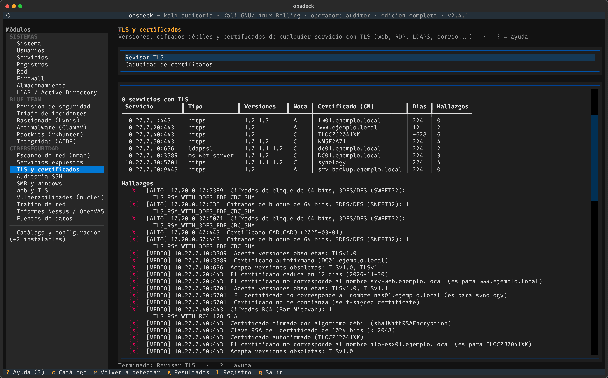
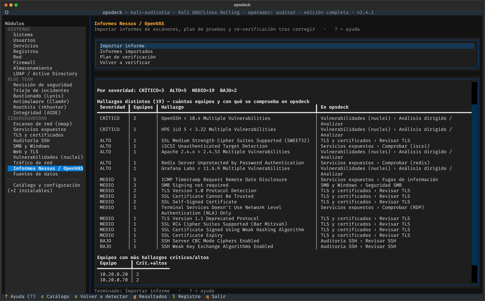
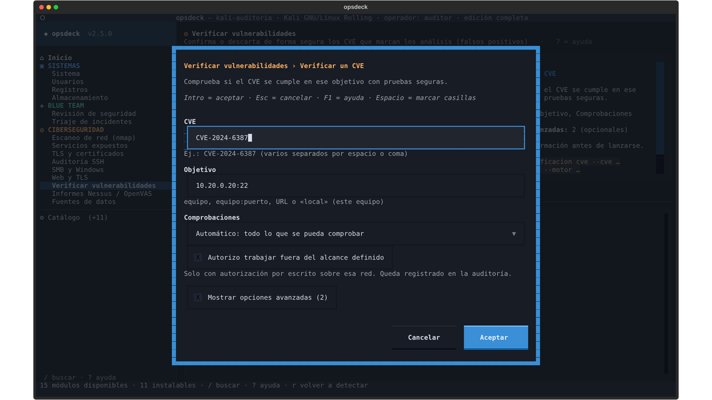

<div align="center">

# opsdeck

**Sistemas y ciberseguridad para Linux en una sola herramienta.**

Administra equipos, únelos a Active Directory, revisa su seguridad, audita redes, servicios y TLS,
comprueba los informes de Nessus y OpenVAS y responde a incidentes, desde un menú visual en la
terminal o en una línea de comando.

[](https://github.com/THRaven426/opsdeck/releases/latest)
[](LICENSE)


[](https://github.com/THRaven426/opsdeck/stargazers)


</div>

> [!WARNING]
> **opsdeck es una herramienta potente.** La edición completa escanea redes, captura tráfico y
> comprueba vulnerabilidades de forma activa. Úsala **solo sobre sistemas propios o con autorización
> por escrito**: hacerlo sobre sistemas ajenos es ilegal. Cada acción queda registrada con su operador.
> Lee el [aviso de uso](AVISO.md).

## Índice

- [Qué hace](#qué-hace)
- [Capturas](#capturas)
- [Ediciones: ligera y completa](#ediciones-ligera-y-completa)
- [Requisitos](#requisitos)
- [Instalación](#instalación)
- [Después de instalar](#después-de-instalar)
- [Primeros pasos](#primeros-pasos)
- [Actualizar](#actualizar)
- [Desinstalar](#desinstalar)
- [Módulos](#módulos)
- [Preguntas frecuentes y problemas habituales](#preguntas-frecuentes-y-problemas-habituales)
- [Cómo funciona por dentro](#cómo-funciona-por-dentro)
- [Seguridad y uso responsable](#seguridad-y-uso-responsable)
- [Desarrollo](#desarrollo)
- [Hoja de ruta](#hoja-de-ruta)
- [Licencia](#licencia)

## Qué hace

| | |
|---|---|
| 🧭 **Se adapta a cada equipo** | En cada arranque detecta qué hay instalado y solo muestra lo que funciona ahí. Si mañana instalas xrdp, su módulo aparece solo. |
| 📦 **Instala lo que falta, como apt** | Enseña los paquetes, las dependencias y el tamaño, y pide confirmación. Nada se instala sin un sí. |
| 🎛️ **Sencilla por defecto, completa si la necesitas** | Cada herramienta se lanza con valores recomendados; las **opciones avanzadas** (velocidad, puertos, plantillas, cabeceras, proxy...) están a un clic. |
| 🔁 **Del informe del escáner al «¿sigue saliendo?»** | Importa informes de Nessus y OpenVAS, reparte el trabajo y vuelve a verificar cada hallazgo tras corregirlo. |
| ❓ **Ayuda en cada pantalla** | La tecla `?` explica el módulo o la acción que tengas seleccionado, con el comando equivalente. |
| 🧾 **Todo queda registrado** | Quién hizo qué y cuándo, en fichero con rotación y en el journal. Las contraseñas nunca se guardan. |
| 🛟 **Difícil romper algo** | Confirmación en lo delicado, copia previa de las cuentas, barandilla de alcance de red y nada de cortar tu propio acceso remoto sin avisar. |
| 🗂️ **Resultados guardados y comparables** | Escaneos, revisiones y análisis se guardan; la herramienta te dice qué ha cambiado desde la vez anterior. |

## Capturas

<div align="center">

| TLS de todos los servicios del último escaneo | Informe de Nessus convertido en trabajo |
|:---:|:---:|
|  |  |
| **Opciones avanzadas, solo si las pides** | **Catálogo: instalar lo que falta** |
|  |  |

<sub>Datos de un laboratorio de ejemplo (10.20.0.0/24, nombres inventados).</sub>

</div>

## Ediciones: ligera y completa

Un solo programa, dos ediciones. Se elige al instalar y se puede cambiar reinstalando.

| | **Ligera** | **Completa** |
|---|:---:|:---:|
| Pensada para | Administración de sistemas y de dominio, día a día | Equipos de seguridad, auditoría y respuesta a incidentes |
| Sistema, usuarios, servicios, registros, red, firewall, discos | ✅ | ✅ |
| Escritorio remoto (xrdp) | ✅ | ✅ |
| Unir el equipo a Active Directory y revisar su estado | ✅ | ✅ |
| Consultas LDAP y revisión del AD (solo lectura) | ✅ | ✅ |
| Revisión de seguridad del equipo | ✅ | ✅ |
| Escaneo de red: descubrir equipos, perfiles rápido y estándar | ✅ | ✅ |
| Escaneo completo, de vulnerabilidades, UDP, sigiloso, infraestructura y personalizado | — | ✅ |
| Servicios expuestos, TLS y certificados, auditoría SSH | — | ✅ |
| SMB y Windows, web, vulnerabilidades (nuclei) | — | ✅ |
| Importar y re-verificar informes de Nessus / OpenVAS | — | ✅ |
| Tráfico de red: captura, análisis y descubrimiento pasivo | — | ✅ |
| Triaje de incidentes, bastionado (Lynis), antimalware, rootkits, integridad | — | ✅ |
| Acceso | Cualquier administrador del equipo | Solo miembros del grupo `opsdeck-completa` |

En la edición completa, quien instala queda dentro del grupo `opsdeck-completa`; a los demás se les
añade con `sudo gpasswd -a <usuario> opsdeck-completa`.

> [!NOTE]
> Ese grupo ordena quién usa qué y deja rastro en la auditoría, pero **no es una barrera** frente a
> alguien con root en el equipo. El control real es en qué máquinas instalas la edición completa y
> quién tiene root en ellas.

## Requisitos

| | |
|---|---|
| Sistema | Debian, Ubuntu o Kali (probados). RHEL/Fedora, openSUSE y Arch: soporte básico, sin probar |
| Python | 3.10 o superior (el instalador lo instala si falta) |
| Permisos | Una cuenta con `sudo` |
| Red durante la instalación | Salida a los repositorios de la distribución y a PyPI (descarga `textual`, ~5 MB) |
| Espacio | Menos de 100 MB la herramienta con su entorno Python; las herramientas de los módulos, según lo que instales |
| Terminal | Cualquiera con UTF-8, también por SSH. Recomendado: 120×35 o más |

## Instalación

Elige **una** de estas formas. Todas dejan lo mismo: la herramienta en `/opt/opsdeck` y el
comando `opsdeck`.

### Opción 1 · Con git (recomendada)

Es la más cómoda: permite actualizar después con un solo comando (`opsdeck autoactualizar`).

```bash
# 1. git, si no lo tienes
sudo apt update && sudo apt install -y git

# 2. Descargar
git clone https://github.com/THRaven426/opsdeck.git
cd opsdeck

# 3. Instalar (pregunta la edición y enseña lo que va a hacer antes de hacerlo)
sudo ./install.sh
```

### Opción 2 · Desde una release, sin git

Para equipos sin git o si prefieres una versión cerrada. Mira el número de la última versión en
[Releases](https://github.com/THRaven426/opsdeck/releases/latest) y sustitúyelo en `VERSION`:

```bash
VERSION=2.4.3
curl -LO https://github.com/THRaven426/opsdeck/archive/refs/tags/v$VERSION.tar.gz
tar -xzf v$VERSION.tar.gz
cd opsdeck-$VERSION
sudo ./install.sh
```

> Instalada así, `opsdeck autoactualizar` no funciona (no hay git): para actualizar, repite estos
> pasos con la versión nueva. La configuración y los datos se conservan.

### Opción 3 · Sin preguntas (scripts, Ansible, imágenes)

```bash
sudo ./install.sh --si --edicion ligera      # o --edicion completa
```

### Opciones del instalador

| Opción | Qué hace |
|---|---|
| *(ninguna)* | Pregunta la edición y pide confirmación antes de tocar nada |
| `--edicion ligera` / `--edicion completa` | Elige la edición sin preguntar |
| `--si` | No pregunta nada (si no indicas edición, conserva la anterior o usa la ligera) |
| `-h`, `--help` | Muestra la ayuda del instalador |

### Otras distribuciones

El instalador detecta la familia y usa su gestor de paquetes. Solo necesitas git (o usar la opción 2):

| Distribución | Antes de la opción 1 |
|---|---|
| Debian, Ubuntu, Kali | `sudo apt install -y git` |
| RHEL, Rocky, Alma, Fedora | `sudo dnf install -y git` |
| openSUSE | `sudo zypper install -y git` |
| Arch | `sudo pacman -S --needed git` |

En las distribuciones no probadas algunas herramientas de los módulos pueden no estar en los
repositorios; el catálogo lo indica.

### Qué hace exactamente el instalador

1. Comprueba qué falta (Python 3.10+ y venv) y te lo enseña, como `apt`.
2. Copia la herramienta a `/opt/opsdeck` y crea su propio entorno Python (no toca el Python del sistema).
3. Crea el comando `/usr/local/bin/opsdeck`, la configuración `/etc/opsdeck/opsdeck.conf` y las
   carpetas de datos `/var/lib/opsdeck` y de registros `/var/log/opsdeck` (solo root).
4. En la edición completa, crea el grupo `opsdeck-completa` y te añade a él.

No instala las herramientas de los módulos (nmap, nuclei, Lynis...): eso se hace después, cuando
las necesites.

## Después de instalar

```bash
opsdeck --version                    # comprobar que está instalada
opsdeck modulos                      # qué módulos hay y qué les falta en este equipo
opsdeck instalar todo                # instalar las herramientas que necesitan los módulos
opsdeck instalar todo --opcionales   # ...y también las que los amplían (sslscan, ssh-audit, testssl...)
opsdeck fuentes actualizar --si      # plantillas de nuclei, exploit-db y listas de paquetes al día
```

**Edición completa — dos pasos más:**

```bash
# Dar acceso a otra persona (debe cerrar sesión y volver a entrar para que cuente)
sudo gpasswd -a <usuario> opsdeck-completa

# Autorizar las redes sobre las que se va a trabajar (además de las conectadas directamente)
opsdeck escaneo alcance --accion añadir --red 10.20.0.0/16
```

> Algunas herramientas (nuclei, netexec, enum4linux-ng, Responder, wpscan) solo están en los
> repositorios de **Kali**. En Debian o Ubuntu el catálogo las marca como no disponibles; si las
> instalas por tu cuenta siguiendo su documentación oficial, opsdeck las detecta solas.

## Primeros pasos

```bash
opsdeck
```

> Escribe solo `opsdeck`: pide la contraseña de `sudo` ella sola. No hace falta `sudo opsdeck`.

| Tecla | Qué hace |
|:---:|---|
| `↑` `↓` `Intro` | Moverse y elegir (también con el ratón) |
| `?` | Ayuda de lo que tengas seleccionado |
| `c` | Catálogo: todos los módulos, instalar lo que falta (`i`) y las herramientas opcionales (`o`) |
| `g` | Resultados guardados |
| `l` | Registro de cambios |
| `s` | Detener la acción en curso |
| `q` | Salir |

En los formularios: `Intro` acepta, `Esc` cancela, `F1` es la ayuda de esa acción y la casilla
**«Mostrar opciones avanzadas»** despliega el resto de opciones de la herramienta.

**Todo se puede lanzar también desde la línea de comandos**, para automatizar:

```bash
opsdeck ayuda escaneo escanear                    # qué pide una acción y sus opciones avanzadas
opsdeck usuarios crear --usuario jperez --grupos sudo
opsdeck revision revisar                          # revisión de seguridad del equipo
opsdeck escaneo escanear --objetivo 10.20.0.0/24 --perfil estandar --tiempo T3 --puertos 1-2000
opsdeck tls revisar                               # TLS de todos los servicios del último escaneo
opsdeck nuclei dirigido --si                      # nuclei solo con las plantillas de lo detectado
opsdeck informes importar --fichero informe.nessus
opsdeck informes verificar --si                   # ¿siguen ahí los hallazgos del informe?
opsdeck registro 20 jperez                        # quién tocó esa cuenta
```

Un valor que empieza por guion se escribe con `=`: `--extra='--reason -sV'`. `--si` confirma sin
preguntar. La guía completa está en [HELP.md](HELP.md) y dentro de la herramienta (`?`).

**Flujo típico de una auditoría de red (edición completa):**

1. *Escaneo de red › Escanear* con el perfil **estándar** o **infraestructura**.
2. Sobre el último escaneo: *Servicios expuestos*, *TLS y certificados*, *Auditoría SSH*, *SMB* y
   *Web y TLS › Revisar las webs del último escaneo*.
3. *Vulnerabilidades (nuclei) › Análisis dirigido por el último escaneo*.
4. Corregir y repetir; o, si partes de un informe de Nessus/OpenVAS, *Informes › Volver a verificar*.

## Actualizar

### Instalación con git (opciones 1 y 3)

```bash
opsdeck autoactualizar
```

Indica la versión instalada y la nueva, pide confirmación, descarga la versión nueva (solo desde un
origen https, sin ejecutar hooks de git) y actualiza su entorno Python con las versiones y hashes fijados; si eso
falla, vuelve a la versión anterior. Conserva la configuración, los datos y los registros. Si avisa
de que el instalador ha cambiado, ejecuta `sudo /opt/opsdeck/install.sh` para aplicar el lanzador
nuevo. Después conviene:

```bash
opsdeck instalar todo --opcionales   # herramientas que pidan los módulos nuevos
opsdeck fuentes actualizar --si
```

Si prefieres hacerlo a mano desde la carpeta donde clonaste el repositorio:

```bash
cd opsdeck && git pull && sudo ./install.sh --si
```

### Instalación desde una release (opción 2)

Descarga la versión nueva y ejecuta su `install.sh` (pasos de la opción 2). Se instala encima y
conserva configuración, datos y registros.

### Cambiar de edición

```bash
sudo ./install.sh --edicion completa    # o ligera; desde la carpeta del repositorio o de la release
```

## Desinstalar

```bash
sudo /opt/opsdeck/uninstall.sh          # pregunta si quieres borrar también datos y registros
sudo /opt/opsdeck/uninstall.sh --todo   # lo borra todo (pide una última confirmación)
```

| Se elimina siempre | Solo con `--todo` (o si respondes que sí) | No se toca |
|---|---|---|
| `/opt/opsdeck` y el comando `opsdeck` | `/var/lib/opsdeck` (resultados, copias, informes) | Las herramientas de los módulos (nmap, xrdp, Lynis...) |
| | `/var/log/opsdeck` (auditoría) | El grupo `opsdeck-completa` |
| | `/etc/opsdeck` (configuración) | La carpeta donde clonaste o descomprimiste |

Para quitar también el grupo: `sudo groupdel opsdeck-completa`. Las herramientas de los módulos se
quitan con el gestor de paquetes (`sudo apt remove ...`).

> Antes de borrar `/var/log/opsdeck`, piensa si tu organización necesita conservar la auditoría.

## Módulos

### 🖥️ Sistemas

| Módulo | Qué resuelve |
|---|---|
| **Sistema** | Estado del equipo, puertos en escucha, servicios con fallos, actualizaciones |
| **Usuarios** | Cuentas locales, contraseñas, grupos, sudo, sesiones, claves SSH, política de caducidad, inventario CSV |
| **Servicios** | systemd: estado con registros, arrancar, parar, reiniciar, arranque automático, timers |
| **Registros** | Errores recientes, accesos fallidos por IP y usuario, accesos correctos, uso de sudo, búsqueda |
| **Red** | Interfaces, rutas, DNS, conexiones activas y "no llego a tal servidor" (DNS, ping, puerto) |
| **Firewall** | ufw o firewalld: reglas, abrir puertos por origen, activar sin cortar SSH ni RDP |
| **Almacenamiento** | Discos e inodos, qué ocupa más, ficheros grandes, limpieza segura |
| **Escritorio remoto** | xrdp: quién entra, por qué alguien no puede, limitar el acceso a un grupo |
| **Dominio (Active Directory)** | Unir el equipo al dominio y adaptarlo a cada implantación; revisión única (salud si está unido, preparación si no) y diagnóstico de contraseña caducada. opsdeck no modifica el AD |
| **LDAP / Active Directory** | Solo lectura: buscar usuarios, miembros anidados, exportar, revisión de seguridad del directorio |

### 🛡️ Blue team

| Módulo | Edición | Qué resuelve |
|---|:---:|---|
| **Revisión de seguridad** | ligera | Los fallos habituales de cuentas, permisos, SSH, firewall, kernel y parches, con su solución y comparados con la revisión anterior |
| **Triaje de incidentes** | completa | Persistencia, procesos sospechosos, ficheros recientes y SUID; recogida de evidencias con manifiesto SHA-256 |
| **Bastionado (Lynis)** | completa | Índice de bastionado de 0 a 100 y su evolución; pruebas concretas, modo sin privilegios y perfiles propios |
| **Antimalware (ClamAV)** | completa | Análisis de carpetas y cuarentena; exclusiones, aplicaciones no deseadas, heurística |
| **Rootkits (rkhunter)** | completa | Rootkits y binarios alterados |
| **Integridad (AIDE)** | completa | Qué ficheros del sistema han cambiado respecto a una referencia |

### 🔎 Análisis y ciberseguridad

| Módulo | Edición | Qué resuelve |
|---|:---:|---|
| **Escaneo de red (nmap)** | ligera / completa | Descubrir equipos (ICMP, ARP, TCP), 8 perfiles, opciones avanzadas de nmap, resumen de una línea por equipo y comparación entre escaneos |
| **Servicios expuestos** | completa | La debilidad típica de cada servicio: RDP sin NLA, iSCSI sin autenticación, SNMP «public», NFS abierto, LDAP anónimo, DNS recursivo o con AXFR, NTP monlist, FTP/TFTP anónimos, BBDD, Redis, MongoDB, Elasticsearch, Docker, VNC sin contraseña, IPMI cifrado 0, UPnP, SMTP; fugas ICMP/TCP timestamp; difusión y DHCP no autorizado |
| **TLS y certificados** | completa | Cualquier servicio con TLS (web, RDP, LDAPS, correo con STARTTLS, BBDD, iLO...): SSL 2/3, TLS 1.0/1.1, SWEET32, RC4, anónimos, NULL/EXPORT, firma débil, claves cortas, autofirmados, no confiables, nombre equivocado, caducidad, DH débil, renegociación, Heartbleed/POODLE; inventario de caducidad |
| **Auditoría SSH** | completa | Algoritmos débiles (KEX, cifrados CBC, MAC, claves de equipo), Terrapin, contraseña aceptada, versión y CVE (ssh-audit) |
| **SMB y Windows** | completa | SMBv1, firma SMB (relay NTLM), MS17-010 y similares, recursos accesibles; netexec por protocolo con enumeración de solo lectura y módulos de comprobación; enum4linux-ng |
| **Web y TLS** | completa | Cabeceras, cookies, métodos HTTP, formularios sin cifrar, páginas por defecto, ficheros sensibles (.git, .env, copias, phpinfo...); whatweb, nikto, testssl, ffuf/feroxbuster/gobuster, wafw00f y wpscan |
| **Vulnerabilidades (nuclei)** | completa | Por severidad, **dirigido por los productos del último escaneo**, paneles, credenciales por defecto y fugas; todas las opciones de nuclei |
| **Tráfico de red** | completa | Quién habla con quién, DNS, protocolos sin cifrar, suplantación ARP; descubrimiento pasivo con LLMNR/NBT-NS/mDNS; Responder en modo análisis |
| **Informes Nessus / OpenVAS** | completa | Importa .nessus, XML, CSV o PDF; resumen, plan de verificación con listas de objetivos y **re-verificación** (sigue / no reproducido / no accesible) |
| **Fuentes de datos** | ligera / completa | Antigüedad y actualización de las bases de detección: plantillas de nuclei, exploit-db y parches |

Tras un análisis, opsdeck añade **«Recomendaciones (siguiente paso)»**: qué confirmar, mitigar o
parchear, con qué módulo comprobarlo de nuevo y, cuando aplica, si existe **exploit público** en
exploit-db para priorizar. Recomienda y señala; no explota nada.

> La administración del propio Active Directory (altas, grupos, GPO) queda fuera a propósito:
> opsdeck configura y revisa el lado Linux.

## Preguntas frecuentes y problemas habituales

<details>
<summary><b>«sudo: opsdeck: command not found»</b></summary>

Escribe solo `opsdeck`: se eleva con sudo por sí mismo. Algunos sistemas no buscan en
`/usr/local/bin` cuando usas `sudo`; el instalador crea un enlace de respaldo, pero no hace falta
escribir `sudo`.
</details>

<details>
<summary><b>Un módulo no aparece en el menú</b></summary>

Pulsa `c` (Catálogo) o ejecuta `opsdeck modulos`: verás si le falta un programa (se instala con `i`
o `opsdeck instalar <módulo>`), si es de la edición completa o si está oculto. Tras instalar algo
por tu cuenta, pulsa `r` para volver a detectar.
</details>

<details>
<summary><b>«Restringido: no pertenece al grupo opsdeck-completa»</b></summary>

Añade la cuenta con `sudo gpasswd -a <usuario> opsdeck-completa` y **cierra sesión y vuelve a
entrar** (los grupos nuevos solo cuentan en sesiones nuevas). `opsdeck edicion` muestra quién tiene
acceso.
</details>

<details>
<summary><b>«Objetivos FUERA del alcance autorizado»</b></summary>

Es la barandilla de alcance: solo se trabaja sobre las redes conectadas directamente y las que
autorices. Añade la red con `opsdeck escaneo alcance --accion añadir --red 10.20.0.0/16` o, para una
vez puntual y con autorización por escrito, marca «Autorizo trabajar fuera del alcance» (queda en la
auditoría).
</details>

<details>
<summary><b>nuclei, netexec, Responder o wpscan no se pueden instalar</b></summary>

Solo están en los repositorios de Kali. En otras distribuciones, instálalos siguiendo su
documentación oficial; cuando estén en el `PATH`, opsdeck los detecta y activa sus acciones.
</details>

<details>
<summary><b>¿Dónde están los resultados?</b></summary>

En `/var/lib/opsdeck/resultados/<módulo>/<fecha>_<objetivo>/` (solo root), y dentro de la
herramienta con la tecla `g`. Se conservan los 50 últimos por módulo (configurable en
`/etc/opsdeck/opsdeck.conf`). La auditoría está en `/var/log/opsdeck/auditoria.log` y en
`journalctl -t opsdeck`.
</details>

<details>
<summary><b>¿Cómo importo un informe de Nessus u OpenVAS?</b></summary>

Exporta el informe como **.nessus** (Nessus) o **XML** (OpenVAS/Greenbone); también sirven CSV y,
como último recurso, PDF. Después: *Informes Nessus / OpenVAS › Importar informe*, *Plan de
verificación* y, tras corregir, *Volver a verificar*.
</details>

<details>
<summary><b>¿Guarda contraseñas?</b></summary>

No. Se pasan a las herramientas por la entrada estándar o en ficheros temporales solo legibles por
root que se borran al terminar, nunca como argumento visible en la lista de procesos. La auditoría
registra quién hizo qué, no las contraseñas.
</details>

<details>
<summary><b>¿Funciona por SSH, sin escritorio, o en cron?</b></summary>

Sí. La interfaz funciona en cualquier terminal (también por SSH o dentro de una sesión de escritorio
remoto) y todo se puede lanzar en una línea con `--si` para scripts y tareas programadas.
</details>

<details>
<summary><b>La interfaz se ve con caracteres raros o descolocada</b></summary>

Usa una terminal con UTF-8 y 256 colores (por ejemplo `export TERM=xterm-256color`) y una ventana
de al menos 120×35. En PuTTY: *Window › Translation › UTF-8*.
</details>

<details>
<summary><b>¿Cómo informo de un fallo?</b></summary>

Abre una [incidencia](https://github.com/THRaven426/opsdeck/issues) con la salida de
`opsdeck --version`, la distribución, la acción que fallaba y el mensaje de error. Revisa que no
incluyas datos de tu red (IP, nombres, usuarios).
</details>

## Cómo funciona por dentro

```
install.sh / uninstall.sh   instalación con confirmación y elección de edición
HELP.md                     guía de uso (la misma que se ve con ?)
opsdeck/
  cli.py                    línea de comandos
  core/                     detección, paquetes, ediciones, auditoría, alcance, recomendaciones, informes
  modules/                  un fichero por módulo
  ui/                       interfaz visual (Textual)
  datos/                    diccionarios mínimos incluidos
tests/                      pruebas del núcleo, de los módulos y de la interfaz
```

| Qué | Dónde |
|---|---|
| Programa | `/opt/opsdeck` |
| Configuración | `/etc/opsdeck/opsdeck.conf` |
| Registro de auditoría | `/var/log/opsdeck/auditoria.log` y `journalctl -t opsdeck` |
| Resultados, informes y copias | `/var/lib/opsdeck` (solo root, con límite de tamaño) |

El código y los datos están separados: en el repositorio no hay datos de ningún equipo.

**Añadir un módulo** es escribir un fichero en `opsdeck/modules/`: declaras qué necesita
(`cmd("nmap", debian="nmap")`), qué lo amplía (`optional`), su ayuda y sus acciones con sus datos
(`Param(..., advanced=True)` para las opciones avanzadas). El menú, los formularios, la línea de
comandos, la detección y la instalación de dependencias salen de esa definición.

## Seguridad y uso responsable

- **Autorización primero.** Los módulos de análisis son para infraestructura propia o con permiso
  por escrito. Las acciones intrusivas lo recuerdan y piden confirmación.
- **Barandilla de alcance.** Los escaneos y las pruebas se confinan a las redes conectadas
  directamente más las que autorices. Un objetivo fuera se **bloquea**; seguir exige marcar que se
  tiene autorización, y queda en la auditoría. No es un muro contra quien tenga root, sino un
  control deliberado contra errores de alcance.
- **Confirma, no explota.** opsdeck detecta, confirma, prioriza y recomienda. No incluye exploits,
  cargas maliciosas, fuerza bruta, volcado de credenciales ni persistencia. Las pruebas de
  credenciales de fábrica y las intrusivas van aparte, desactivadas por defecto y con confirmación.
- **Capturar tráfico afecta a la privacidad** de quien usa la red: hazlo dentro del procedimiento de
  tu organización. El resumen usa metadatos y no muestra contenido ni credenciales.
- **Trazabilidad.** Cada cambio y cada análisis queda en la auditoría con operador, objetivo y resultado.
  El operador sale de la sesión con la que se entró (no de variables que se puedan falsear).
- **Equivale a root.** opsdeck se ejecuta como root y administra cuentas, sudo y servicios: quien
  pueda abrirlo administra el equipo. Concede `sudo` para opsdeck solo a administradores. La
  herramienta impide que alguien se dé a sí mismo sudo o grupos privilegiados, y nadie puede hacer
  que cargue código suyo (entorno limpio, sin rutas ni ficheros en las opciones adicionales, sin
  seguir enlaces al leer ficheros de usuarios).
- **Dependencias verificadas.** Las de Python se instalan con versión y hash fijados
  (`requirements.txt`); los informes XML de terceros se leen con `defusedxml`.
- **Los avisos no son veredictos.** Un hallazgo es un punto de partida para investigar.

## Desarrollo

```bash
git clone https://github.com/THRaven426/opsdeck.git && cd opsdeck
python3 -m venv .venv && .venv/bin/pip install --require-hashes --no-deps -r requirements-dev.txt
sudo OPSDECK_DATA=/tmp/od OPSDECK_LOG=/tmp/od OPSDECK_CONF=/tmp/od/od.conf .venv/bin/python -m pytest -q
```

Las pruebas crean y borran cuentas y ficheros de prueba: ejecútalas en una máquina de pruebas, como root.

## Hoja de ruta

- [x] Base, instalador, catálogo con detección, ayuda integrada
- [x] Administración de sistemas y unión a Active Directory
- [x] Blue team: revisión, triaje, bastionado, antimalware, rootkits, integridad
- [x] Análisis: escaneo, tráfico, SMB, web y TLS, nuclei
- [x] Ediciones ligera y completa
- [x] Barandilla de alcance de red (confinamiento a redes autorizadas, registrado)
- [x] Recomendación del siguiente paso según los descubrimientos (con consulta de exploit público)
- [x] Fuentes de detección al día
- [x] Dominio: revisión única, diagnóstico de contraseña caducada y reparto por ediciones
- [x] Opciones avanzadas en todas las herramientas; herramientas opcionales instalables
- [x] TLS de cualquier servicio, auditoría SSH, servicios expuestos, informes Nessus/OpenVAS con re-verificación
- [ ] Hallazgos unificados y persistentes con estado (abierto / corregido / aceptado)
- [ ] Flujos guiados: alta de equipo, auditoría de red, securizar un equipo
- [ ] Informe consolidado por equipo y por red
- [ ] RHEL, SUSE y Arch probados
- [ ] Herramienta hermana para Windows, centrada en administrar Active Directory

## Licencia

Copyright © 2026 THRaven426.

opsdeck es software libre: puedes redistribuirlo y modificarlo bajo los términos de la
**[GNU General Public License v3.0](LICENSE)**. Quien distribuya una versión modificada debe
publicarla con la misma licencia y con su código fuente.

Se distribuye **TAL CUAL, SIN NINGUNA GARANTÍA**, ni siquiera la implícita de comerciabilidad o de
idoneidad para un propósito concreto (secciones 15 y 16 de la licencia). El autor no responde del
uso que se haga de la herramienta ni de sus consecuencias: cada usuario es responsable de contar con
autorización sobre los sistemas que analiza. Más detalle en el [aviso de uso](AVISO.md).
